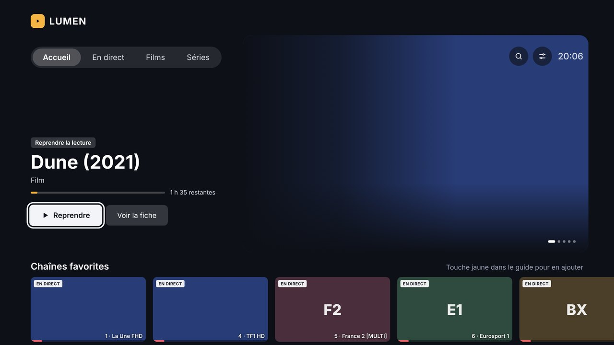
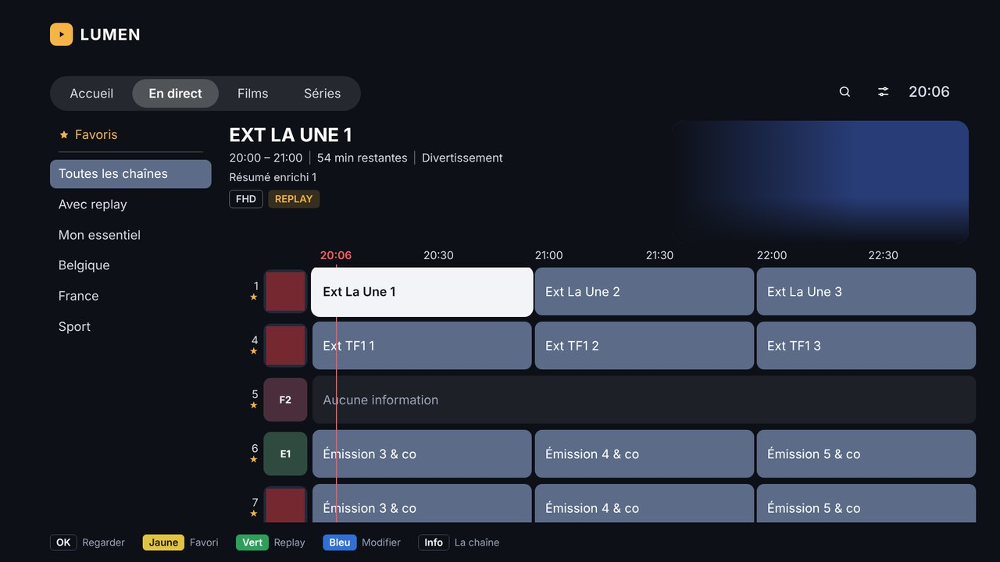
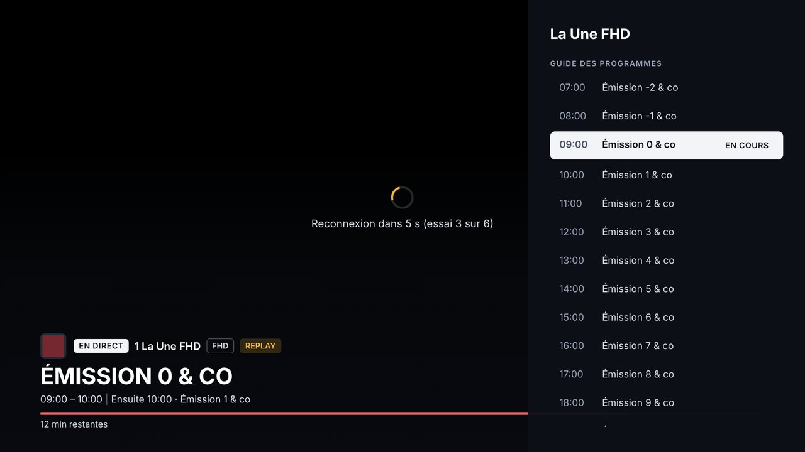
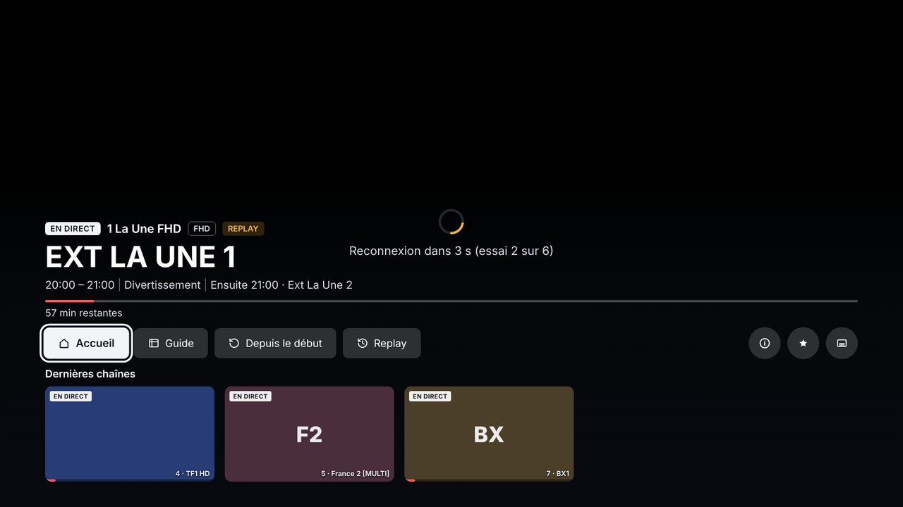
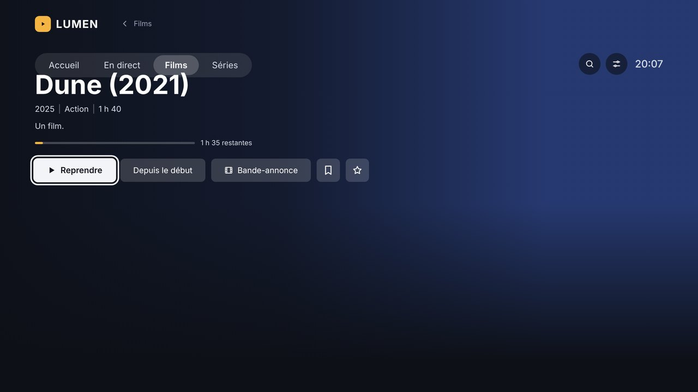

<div align="center">

# LUMEN

**A careful IPTV interface for Samsung Tizen televisions, with a server of its own.**

[Français](README.md) · [Documentation](docs/en/) · [Downloads](../../releases)

[](LICENSE)



</div>

> **Note** — LUMEN's own interface is in French. The documentation is bilingual, the application is not (yet). If you would like to translate it, see [CONTRIBUTING.md](CONTRIBUTING.md): the strings sit in a handful of files.

---

## What it is

IPTV apps on Samsung televisions are slow, ugly, and dump all 9,000 of your provider's channels on you without distinction. LUMEN replaces them with an interface that looks like the television's own, only cleaner, and with a small server that does the heavy work on its behalf.

The split is deliberate. A television is a slow machine, so it only draws. The server holds the catalogue, cleans up names, keeps the programme guide, resizes artwork and serves your own media library. The app never asks for anything but JSON that is already prepared.

> **LUMEN provides no channels and no content.** It is a player, like VLC. You need your own subscription from an Xtream Codes compatible provider.

## In pictures

| | |
|---|---|
|  |  |
| **Live** — channel grid, bouquets on the left | **Guide** — video preview, 7 days of programmes |
|  |  |
| **Player** — two-stage info bar, quick zapping | **Films** — posters, synopses, resume playback |

## What it does

**On the television**

- Home screen with resume playback, favourite channels, recently watched
- Channel grid with bouquets, search, and numbering you choose
- Seven-day programme guide with a video preview of the highlighted channel
- An info bar that opens in two stages: discreet first, full on OK
- Quick zapping on the left key, programme sheets on OK
- Films and series with posters, backdrops, synopses, seasons and episodes
- Catch-up on channels that offer it
- Everything driven from the remote, designed to be used without looking down

**On the server**

- Xtream Codes catalogue sync, plus XMLTV programme guide where you need one
- Personal bouquets for channels, films and series
- Name cleaning rules (`|FR| Dune 2021 FHD` becomes `Dune`), and manual renaming
- Entry editor: title, synopsis, poster and backdrop, from the web, TMDB or your PC
- Replaceable channel logos
- Media library: your local or SMB files, recognised and dressed up by TMDB
- Automatic start: LUMEN opens when the television powers on, instead of Samsung TV Plus
- A settings page in the browser; everything is set from there

## What you need

| | |
|---|---|
| **A Samsung television** | Tizen, with developer mode. Tested on a 2026 UE55M73HAUXXN. |
| **A machine for the server** | A Proxmox LXC container, a Raspberry Pi, an old laptop: anything that stays on. Python 3.11 or newer. |
| **An IPTV subscription** | Xtream Codes compatible (`player_api.php`). |
| **A computer** | To install the app on the television. Linux, macOS or Windows. |
| **A TMDB key** | Optional. Free, and only needed for the media library and the entry editor. |

The server uses **nothing but the Python standard library**, plus Pillow for thumbnails. Nothing to install, nothing to maintain, no dependency that breaks at the next update.

## Quick install

```bash
# On the machine that will be the server
tar xzf lumen-server.tar.gz
sh install.sh
```

Then open `http://SERVER-ADDRESS:8765/reglages`, fill in your IPTV credentials, and run a first sync.

For the television you need developer mode and the `.wgt` file. It is set out step by step in [installing on the television](docs/en/installation-tv.md).

➡️ **[Full installation guide](docs/en/installation.md)**

## Documentation

- [Server installation](docs/en/installation.md)
- [Installing on the television](docs/en/installation-tv.md)
- [Bouquets and name cleaning](docs/en/bouquets-and-names.md)
- [Fixing entries and logos](docs/en/entries-and-logos.md)
- [The media library](docs/en/media-library.md)
- [Starting LUMEN with the television](docs/en/automatic-start.md)
- [The programme guide](docs/en/guide.md)
- [When it does not work](docs/en/troubleshooting.md)
- [How it is built](docs/en/architecture.md)

## Taking part

Feedback, bug reports and tested television models are all welcome — above all models other than the one LUMEN was written on. See [CONTRIBUTING.md](CONTRIBUTING.md).

If LUMEN runs on your set, say so in an issue: a list of televisions that work is what is missing most.

## License

[GPL-3.0](LICENSE). You may use, modify and share LUMEN freely; any modified version you distribute must stay free and open.

## Notices

This product uses the TMDB API but is not endorsed or certified by TMDB.

LUMEN is not affiliated with Samsung. Tizen and Samsung TV Plus are trademarks of Samsung Electronics.
