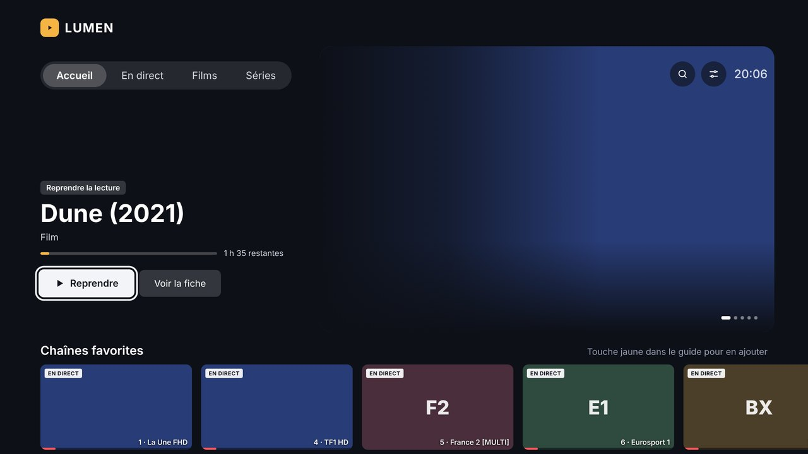
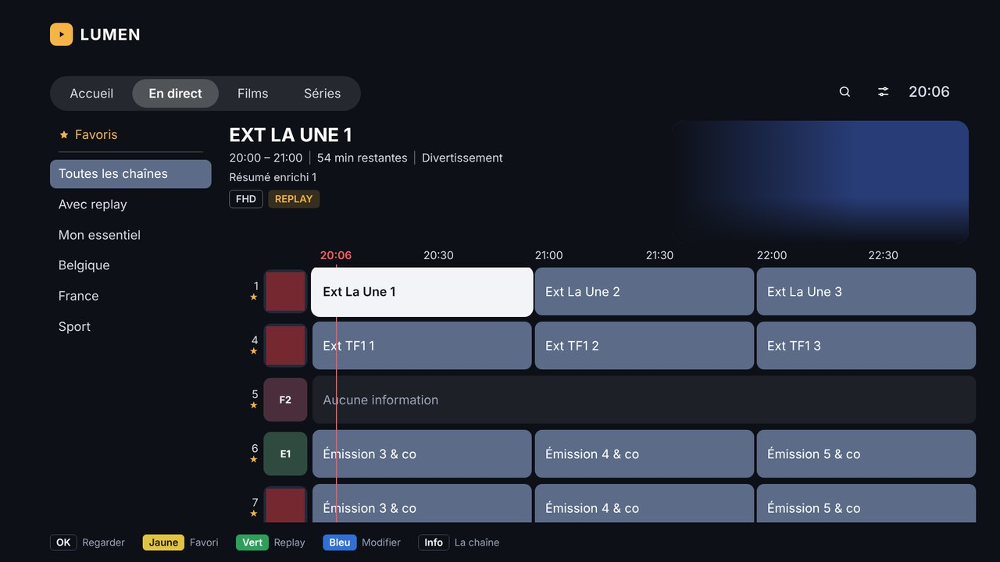
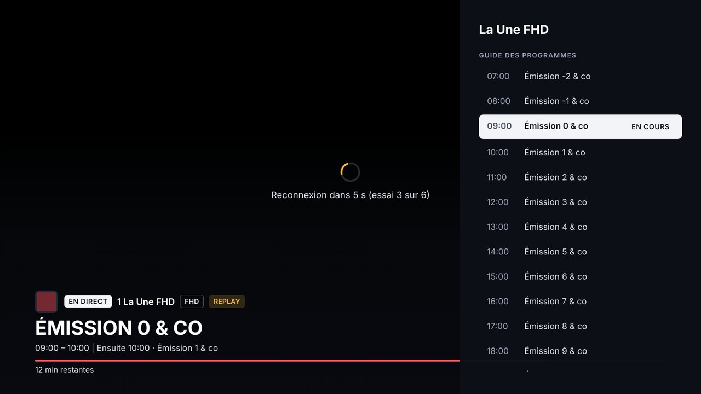
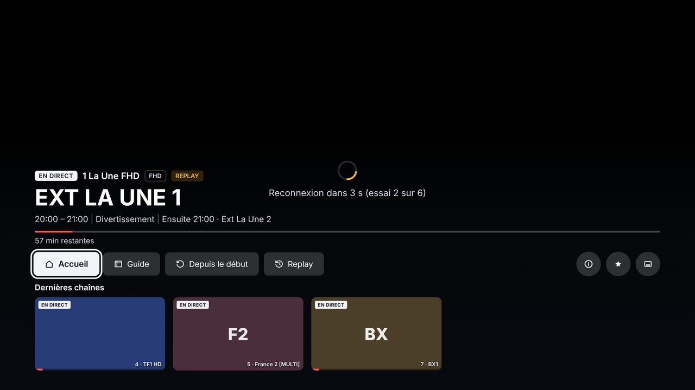
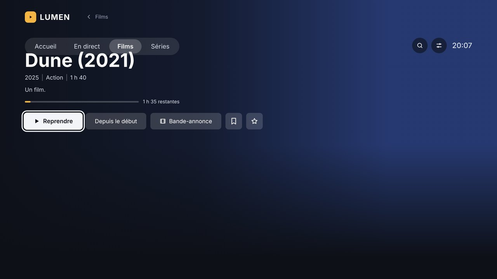

<div align="center">

# LUMEN

**Une interface IPTV soignée pour les téléviseurs Samsung Tizen, avec son propre serveur.**

[English](README.en.md) · [Documentation](docs/) · [Téléchargements](../../releases)

[](LICENSE)



</div>

---

## Ce que c'est

Les applications IPTV des téléviseurs Samsung sont lentes, laides, et affichent les 9 000 chaînes du fournisseur sans distinction. LUMEN remplace tout ça par une interface qui ressemble à celle du téléviseur, en plus propre, et par un petit serveur qui fait le gros du travail à sa place.

Le partage des rôles est volontaire : le téléviseur est une machine lente, alors il ne fait qu'afficher. Le serveur garde le catalogue, nettoie les noms, tient le guide des programmes, fabrique les vignettes à la bonne taille et sert la médiathèque. L'application ne demande jamais rien d'autre que du JSON déjà prêt.

> **LUMEN ne fournit aucune chaîne et aucun contenu.** C'est un lecteur, comme VLC. Il vous faut votre propre abonnement auprès d'un fournisseur compatible Xtream Codes.

## En images

| | |
|---|---|
|  |  |
| **Le direct** — grille de chaînes, bouquets à gauche | **Le guide** — aperçu vidéo, 7 jours de programmes |
|  |  |
| **Le lecteur** — barre d'info en deux temps, zapping rapide | **Les films** — jaquettes, résumés, reprise de lecture |

## Ce que ça sait faire

**Côté téléviseur**

- Accueil avec reprise de lecture, chaînes favorites, dernières chaînes regardées
- Grille de chaînes avec bouquets, recherche, numérotation à vous
- Guide des programmes sur 7 jours, avec aperçu vidéo de la chaîne survolée
- Barre d'info qui s'ouvre en deux temps : discrète d'abord, complète sur OK
- Zapping rapide par la touche gauche, fiches de programmes sur OK
- Films et séries avec jaquettes, fonds, résumés, saisons et épisodes
- Replay sur les chaînes qui le proposent
- Navigation entièrement à la télécommande, pensée pour s'y retrouver sans regarder le clavier

**Côté serveur**

- Synchronisation du catalogue Xtream Codes, guide des programmes XMLTV en plus si besoin
- Bouquets personnels pour les chaînes, les films et les séries
- Règles de nettoyage des noms (`|FR| Dune 2021 FHD` devient `Dune`), et renommage à la main
- Éditeur de fiches : titre, résumé, jaquette et fond, depuis le web, TMDB ou votre PC
- Logos de chaînes remplaçables
- Médiathèque : vos fichiers locaux ou SMB, reconnus et habillés par TMDB
- Démarrage automatique : LUMEN s'ouvre quand le téléviseur s'allume, à la place de Samsung TV Plus
- Page de réglages dans le navigateur, tout est réglable là

## Ce qu'il vous faut

| | |
|---|---|
| **Un téléviseur Samsung** | Tizen, avec le mode développeur. Testé sur un UE55M73HAUXXN de 2026. |
| **Une machine pour le serveur** | Un conteneur LXC Proxmox, un Raspberry Pi, un vieux portable : n'importe quoi qui tient allumé. Python 3.11 ou plus récent. |
| **Un abonnement IPTV** | Compatible Xtream Codes (`player_api.php`). |
| **Un ordinateur** | Pour installer l'application sur le téléviseur. Linux, macOS ou Windows. |
| **Une clé TMDB** | Facultative. Gratuite, et seulement utile pour la médiathèque et l'éditeur de fiches. |

Le serveur n'utilise **que la bibliothèque standard de Python**, plus Pillow pour les vignettes. Rien à installer, rien à maintenir, aucune dépendance qui casse à la prochaine mise à jour.

## Installation rapide

```bash
# Sur la machine qui fera serveur
tar xzf lumen-server.tar.gz
sh install.sh
```

Puis ouvrez `http://ADRESSE-DU-SERVEUR:8765/reglages`, renseignez vos identifiants IPTV, et lancez une première synchronisation.

Pour le téléviseur, il faut activer le mode développeur et y envoyer le fichier `.wgt`. C'est expliqué pas à pas dans [l'installation sur le téléviseur](docs/installation-televiseur.md).

➡️ **[Guide d'installation complet](docs/installation.md)**

## Documentation

- [Installation du serveur](docs/installation.md)
- [Installation sur le téléviseur](docs/installation-televiseur.md)
- [Les bouquets et le nettoyage des noms](docs/bouquets-et-noms.md)
- [Corriger les fiches et les logos](docs/fiches-et-logos.md)
- [La médiathèque](docs/mediatheque.md)
- [Démarrer LUMEN avec le téléviseur](docs/demarrage-automatique.md)
- [Le guide des programmes](docs/guide.md)
- [Quand ça ne marche pas](docs/depannage.md)
- [Comment c'est fait](docs/architecture.md)

## Participer

Les retours, les rapports de bugs et les modèles de téléviseurs testés sont les bienvenus — surtout les modèles autres que celui sur lequel LUMEN a été écrit. Voyez [CONTRIBUTING.md](CONTRIBUTING.md).

Si LUMEN tourne chez vous, dites-le dans une *issue* : la liste des téléviseurs qui marchent est ce qui manque le plus.

## Licence

[GPL-3.0](LICENSE). Vous pouvez utiliser, modifier et partager LUMEN librement ; toute version modifiée que vous distribuez doit rester libre et ouverte.

## Mentions

Ce produit utilise l'API de TMDB, sans être approuvé ni certifié par TMDB.

LUMEN n'a aucun lien avec Samsung. Tizen et Samsung TV Plus sont des marques de Samsung Electronics.
